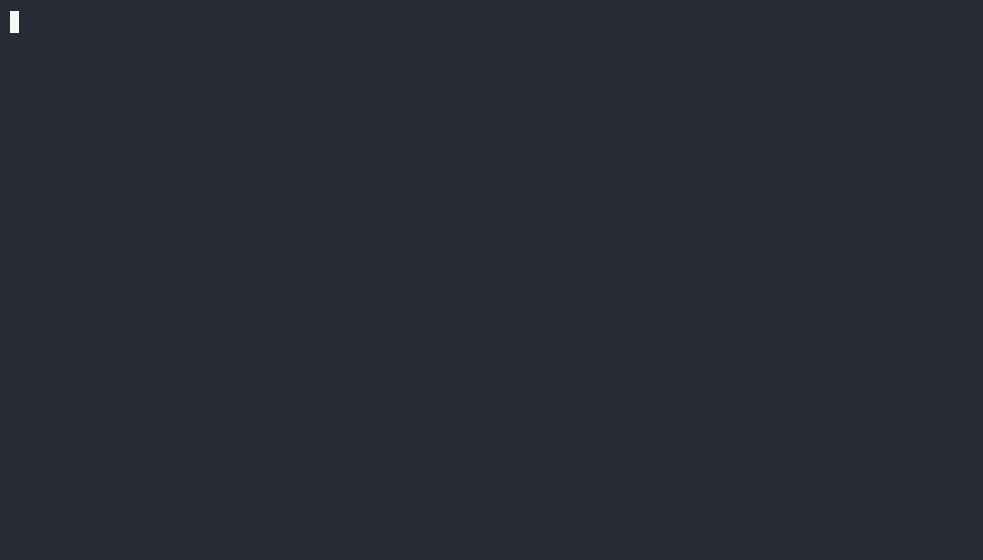
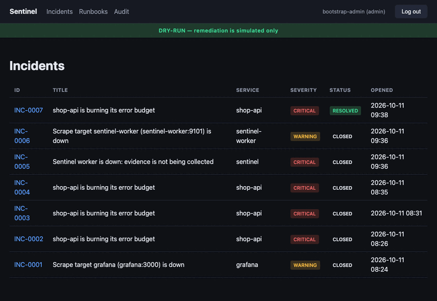

# Sentinel: AI SRE & Incident Response Platform

[](https://github.com/Akanksha1809/Sentinel-AI-SRE/actions/workflows/ci.yml)
[](LICENSE)

Sentinel detects production-like incidents and correlates metrics and logs with recent changes. It investigates likely root causes with an LLM that is grounded in evidence and has **no tools**, proposes remediation only from an allowlisted runbook catalogue, executes approved actions through a least-privilege actuator, and verifies recovery against measured health signals.

> **Status: Phase 8 of 8 complete.** Alerts become audited incidents; a worker gathers evidence, investigates, and *recommends* an allowlisted runbook. An approver signs off, the actuator executes it, and recovery is only reported after real Prometheus checks pass for several samples in a row. A server-rendered dashboard (session-cookie auth, no client-side JS) covers incident triage, approvals, and a postmortem generator built from stored facts, never a new AI call. Three scripted demo scenarios run end to end against the real stack, in CI and locally. See [PROJECT_STATUS.md](PROJECT_STATUS.md).

## Why this exists

Most "AI DevOps" demos stop at "the model suggested something." Sentinel is built
around the part that actually matters for production use: **the LLM never executes
anything**. It returns a schema-validated hypothesis that can only *reference*
runbook IDs from an allowlisted catalogue; a human with the `approver` role signs
off; a least-privilege actuator (never the model, never Sentinel itself) makes the
change; and the incident isn't marked resolved until real Prometheus samples —
several in a row — confirm it. Every one of those boundaries is covered by a test
that tries to break it, not just a test that exercises the happy path.

It's also tested the way production software actually gets tested: every phase
ended with **live verification against the real running stack**, not just green
unit tests. That process found 20+ real bugs across the project — a PromQL join
missing `on(service)` that would have made recovery verification silently never
pass, a `NaN` from Prometheus that crashed JSON storage, a deployment-correlation
bug that could misattribute an incident's root cause, a hardcoded Docker socket
group that broke CI the first time it ran on a non-Colima host. All of them are
written up with the live evidence in [PROJECT_STATUS.md](PROJECT_STATUS.md) —
including the ones found *this week*, after the project was otherwise "done."

**[Watch scenario B end to end](#try-it-run-a-demo-scenario-end-to-end)** — a bad
deploy, detected, investigated, approved, rolled back, and verified, narrated by
the CLI against the real stack:



Same incident, in the dashboard: the incident list, Observations (measured data)
vs. AI Hypotheses (labelled MOCK, never presented as fact) split, the remediation
timeline, and the approval record with its runbook content-hash check:



## What runs today
| Component | Role |
|---|---|
| **shop-api** | Demo checkout service with deterministic faults: memory pressure, a broken release (1.1.0), a crash-looping config (r2) |
| **actuator** | The only component that can change workloads. Catalogue-allowlisted deploy/rollback/restart/scale; idempotent; dry-run |
| **docker-guard** | Docker API admission controller: blocks privileged/mounted/escalated containers and changes to anything Sentinel doesn't manage |
| **Prometheus / Alertmanager** | SLIs, SLO burn-rate alerts, saturation and crash-loop alerts |
| **Loki / Alloy / Grafana** | Centralised logs (labelled by version and config revision) and a provisioned service dashboard |
| **Sentinel API** | Alertmanager webhook ingestion, incident lifecycle, deployment history, RBAC, hash-chained audit log, action propose/approve/reject, postmortem generate/edit/finalize, and a server-rendered web UI (http://127.0.0.1:8080/, JSON API docs at /api/docs) |
| **Sentinel worker** | Evidence collection, investigations (MOCK by default or a local Ollama model), and remediation: executes approved actions against the actuator and verifies recovery against measured Prometheus signals before resolving the incident |

## Quick start (macOS/Linux, Docker + uv)
```bash
make setup && make secrets && make images && make up
```
The API's bootstrap admin token is in `secrets/sentinel_admin_token`; create scoped tokens with `make token NAME=alice ROLE=responder` (roles: viewer, responder, approver, admin). Open Grafana at http://127.0.0.1:3000 (user `admin`; password in `secrets/grafana_admin_password`), Prometheus at http://127.0.0.1:9090, or Alertmanager at http://127.0.0.1:9093. All ports bind to localhost only.

Remediation defaults to **dry-run** (the actuator is called, but every call is forced `dry_run=true`; nothing ever changes). Set `SENTINEL_EXECUTION_MODE=live` before `make up` to let approved actions actually execute.

```bash
make test    # unit + policy, integration (Postgres via Docker), promtool, amtool
make check   # lint, mypy --strict, tests, bandit, pip-audit
make down    # stop (make clean also deletes volumes)
```

### Try it: run a demo scenario end to end

```bash
make e2e-up          # stack up, SENTINEL_EXECUTION_MODE=live (a real fix, not a no-op)
make demo-list       # see what each scenario does
uv run sentinel-demo run b   # a: memory leak, b: bad release, c: bad config
```

Narrates fault → alert → incident → (mock) investigation → your approval → real
actuator remediation → verified recovery, against the actual running stack. `make
test-e2e` runs the same three scenarios as an automated suite (what CI's `e2e` job
runs on every push). See [docs/demo-recording.md](docs/demo-recording.md) to capture
one as an asciinema recording.

## Design documents
- [Architecture](docs/architecture.md): components, data flow, decisions, measured scenario timings
- [Threat model](docs/threat-model.md): including the live Docker boundary probe
- [Data model](docs/data-model.md) and [API contracts](docs/api-contracts.md)
- [Implementation plan](docs/implementation-plan.md)
- [Troubleshooting](docs/troubleshooting.md)
- [Authoring a runbook](docs/runbook-authoring.md)
- [Recording a demo](docs/demo-recording.md)
