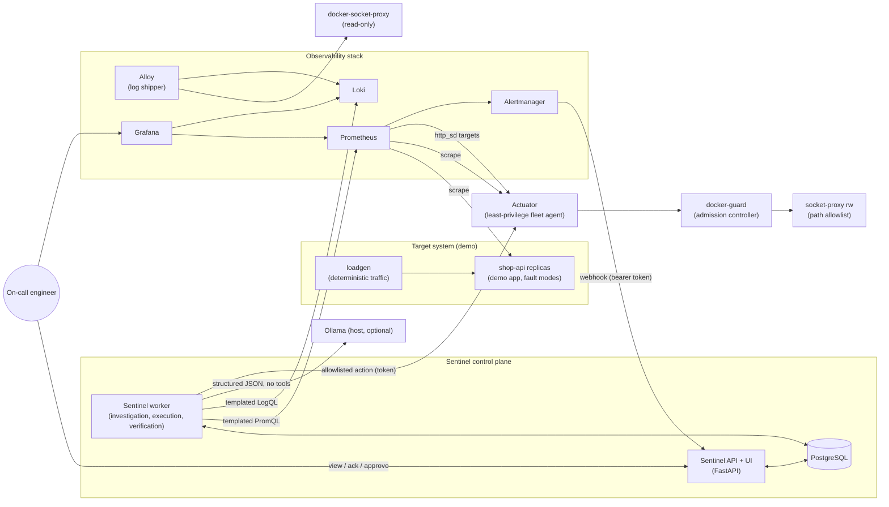

# Sentinel — Architecture

> Status: Phases 1–6 implemented (target system, monitoring, ingestion/incidents, evidence,
> investigation, remediation). The dashboard UI and postmortems (Phase 7) are still design;
> see `PROJECT_STATUS.md`.

Sentinel is an AI-assisted SRE incident response platform. It detects incidents
from real alert signals, collects evidence from metrics, logs and change history,
asks an LLM (or a deterministic mock) for *hypotheses* grounded in that evidence,
proposes remediation **only from an allowlisted runbook catalogue**, executes
approved actions through a narrow least-privilege actuator, and declares recovery
only after measured health checks pass.

---

## 1. Environment findings (inspected 2026-10-09)

Decisions below are based on what is actually installed, not assumed.

| Item | Finding | Consequence |
|---|---|---|
| Repository | Empty, not a git repo | Greenfield layout; `git init` at start of Phase 2 |
| Host | macOS 15 (Darwin 24.6), Apple Silicon arm64, **8 GB RAM**, 8 cores, **~22 GB free disk** | Tight memory budget; all images must be arm64-capable; keep image count low |
| Python | System 3.9.6; **Homebrew 3.12.15** at `/opt/homebrew/bin/python3.12` | Use 3.12 venv explicitly; never system Python |
| Package manager | `uv`, `poetry`, `pip-tools` **not installed**; pip 26.2.1 present | Open decision (see plan): install `uv` or use pip + hashed lock file |
| Docker | Docker CLI 29.6.1 + **standalone** `docker-compose` v5.3.1 (no `docker compose` plugin) via **Colima** (vz, 4 CPU / 8 GiB VM) | Makefile calls `docker-compose`; Colima-specific host networking |
| Existing containers | `ai-platform-engineer-jenkins` (~0.8 GB) and a kind node (~3.2 GB) already running | ~4 GB of the VM is already used by another project. Sentinel must not touch them; README will recommend pausing them during demos |
| Kubernetes | `kubectl`, `kind`, `minikube`, `helm` installed; context `kind-ai-platform-engineer` (another project's cluster) | K8s backend is **optional**; it will never target the current context by default; it uses its own namespace or its own kind cluster |
| **Ollama** | **v0.32.0**, app at `/Applications/Ollama.app`, CLI symlink `/usr/local/bin/ollama` → `/Applications/Ollama.app/Contents/Resources/ollama`. Models in `~/.ollama/models` (4.4 GB): **`qwen2.5-coder:7b`** (4.68 GB Q4). Server **not running** at check time (`localhost:11434` refused) | Ollama runs **natively on the host** (Metal GPU), not in Compose. Sentinel reaches it via Colima's host alias. Mock provider is the default |
| Node.js | Not installed | UI is server-rendered (Jinja2 + vendored htmx). No JS build chain |
| psql | Not installed | Use `docker-compose exec postgres psql` for debugging |
| GitHub CLI | Installed, authenticated | CI can be pushed later, **only with your approval** |

### Verified dependency versions

Resolved together on Python 3.12 with `pip install --dry-run`: 94 packages, no conflicts.

| Python package | Version | | Container image | Tag |
|---|---|---|---|---|
| fastapi | 0.143.0 (starlette 1.7.0) | | prom/prometheus | v3.13.4 (patch line; v3.15.0 is newest minor) |
| uvicorn[standard] | 0.54.0 | | prom/alertmanager | v0.34.1 |
| pydantic / pydantic-settings | 2.14.0 / 2.15.0 | | grafana/grafana | 13.2.3 |
| sqlalchemy[asyncio] | 2.1.4 | | grafana/loki | 3.7.8 |
| alembic | 1.20.0 | | grafana/alloy | v1.20.1 (Promtail is deprecated/EOL) |
| psycopg[binary] | 3.3.6 | | postgres | 18.6 |
| httpx | 0.28.1 | | python (base) | 3.12.15-slim |
| prometheus-client | 0.26.0 | | tecnativa/docker-socket-proxy | pinned in Phase 2 |
| structlog | 26.1.0 | | | |
| tenacity | 9.2.1 | | | |
| jinja2 | 3.1.6 | | | |
| pytest / pytest-asyncio | 9.1.1 / 1.4.0 | | | |
| respx | 0.23.1 | | | |
| testcontainers[postgres] | 4.15.0 | | | |
| ruff / mypy | 0.16.10 / 2.4.0 | | | |
| bandit / pip-audit | 1.9.4 / 2.10.1 | | | |
| docker (SDK, actuator only) | 7.2.0 | | | |
| kubernetes (optional) | 37.0.0 | | | |

Image tags are pinned exactly in Compose. Digest pinning gets added in Phase 8.

---

## 2. System context



### Trust boundaries

1. **Untrusted data plane**: alert payloads, log lines, metric label values, and LLM output.
2. **Sentinel control plane**: API, worker, and Postgres. It holds no Docker or cluster credentials.
3. **Actuator**: the only component that can change running workloads. It reaches Docker through two filters in series: `docker-guard` (validates container-create bodies; refuses to touch unmanaged containers) and `socket-proxy-rw` (regex path allowlist, no host bind mounts). It is never on the same network as the proxy.
4. **Host**: no service mounts the raw Docker socket except the two socket proxies. Demo containers get no host paths, run with memory/CPU/PID limits, drop all capabilities, and use read-only root filesystems where practical.

---

## 3. Components

| Component | Responsibility | Talks to | Privileges |
|---|---|---|---|
| **shop-api** (`services/demo-app`) | Small FastAPI "checkout" service. Emits RED metrics, process metrics, and JSON logs. Has deterministic fault modes (memory pressure, broken release, crash on start) | — | Internal network only. Chaos endpoints require a token and take bounded parameters |
| **loadgen** (`services/loadgen`) | Fixed-rate, seeded request mix against `shop-api` (Docker DNS round-robin across replicas) | shop-api | none |
| **Actuator** (`services/actuator`) | Owns the demo "fleet": deploy a version, restart, scale (1..N). Exposes `http_sd` targets to Prometheus, fleet metrics (restart count, container memory/limit, deployed version), and emits deployment events to Sentinel | docker-socket-proxy (rw), Sentinel `/api/v1/deployments` | Only acts on containers labelled `sentinel.managed=true`. Creates containers from a **fixed in-code template** (no user-supplied mounts, image, or command). Image tag comes from an allowlisted release catalogue |
| **docker-guard** (`actuator.guard`) | Admission controller: allowlist validation of `containers/create` bodies (image pattern, no privileged/mounts/devices/caps/host namespaces/ports, mandatory hardening + limits, env/network allowlists); server-side `sentinel.managed` check before stop/restart/kill/delete | socket-proxy-rw | No socket. Non-root, read-only rootfs. Added after a live probe showed path filtering alone admits privileged containers |
| **socket-proxy-rw** (`wollomatic/socket-proxy`) | Regex path allowlist: container create/start/stop/restart/delete/inspect/stats, image inspect; host bind mounts disabled | Docker socket | `allowfrom=docker-guard`, internal network shared only with the guard |
| **socket-proxy-ro** | GET-only container list/inspect/logs + network list for Alloy | Docker socket | `allowfrom=alloy`, internal network |
| **Prometheus** | Scraping, recording rules (SLIs, SLO burn rates), alert rules | targets, Alertmanager | — |
| **Alertmanager** | Grouping, inhibition, and webhook delivery to Sentinel with a bearer token from `credentials_file` | Sentinel | — |
| **Loki + Alloy** | Centralised logs, labelled by `service`, `version`, `container` | — | — |
| **Grafana** | Provisioned dashboards (service RED, SLO, fleet, Sentinel self-metrics) and deep links from the Sentinel UI | Prometheus, Loki | anonymous viewer disabled; admin password from secret |
| **Sentinel API** | Webhook ingestion, incident lifecycle, REST API, server-rendered UI, auth/RBAC, audit, health/readiness, `/metrics` | Postgres | DB role `sentinel_app` (no DDL, no UPDATE/DELETE on audit) |
| **Sentinel worker** | Async job runner (Postgres-backed queue using `SELECT … FOR UPDATE SKIP LOCKED`): evidence collection, investigation, action execution, recovery verification | Postgres, Prometheus, Loki, Ollama, Actuator | Same DB role plus the actuator token |
| **Postgres** | Incidents, alerts, events, evidence, investigations, actions, approvals, audit chain | — | Separate migration role (`sentinel_migrator`) and app role |
| **Ollama** (optional) | Local LLM through `/api/chat` with a JSON-schema `format`, `temperature=0`, and a fixed `seed` | — | Stays on host loopback. Containers reach it through Colima's `host.lima.internal`, which is verified in Phase 5 |

**Why an API process plus a worker process (one image, two entrypoints):** investigations and verification windows take seconds to minutes. Keeping them out of request handlers means webhooks stay fast and idempotent. A Postgres-backed queue avoids adding Redis, which saves memory.

---

## 4. Core data flow (incident lifecycle)

```mermaid
sequenceDiagram
    autonumber
    participant P as Prometheus
    participant AM as Alertmanager
    participant API as Sentinel API
    participant DB as Postgres
    participant W as Worker
    participant L as Loki
    participant LLM as Investigation provider (mock | Ollama)
    participant H as Approver
    participant A as Actuator

    P->>AM: alert firing (e.g. ShopApiHighErrorBurnRate)
    AM->>API: POST /api/v1/webhooks/alertmanager (bearer)
    API->>API: validate size/schema → normalise → fingerprint
    API->>DB: upsert alert (dedupe), attach to open incident for service or create one, timeline event
    API->>DB: enqueue job collect_evidence(incident)
    W->>P: templated PromQL (error ratio, latency p95, memory/limit, restarts, up)
    W->>L: templated LogQL (errors for service, bounded lines)
    W->>DB: deployments in lookback window, change correlation score
    W->>DB: store Evidence items (observations, with query + raw data)
    W->>LLM: InvestigationRequest (evidence as delimited, escaped DATA; runbook catalogue)
    LLM-->>W: JSON matching InvestigationReport schema
    W->>W: validate schema, verify evidence citations exist, map actions to allowlisted runbooks only
    W->>DB: Investigation + hypotheses (labelled AI-generated, provider/model recorded)
    W->>DB: ActionRequest(s) proposed → pending_approval (policy decides)
    H->>API: approve action (RBAC approver, CSRF, optional 4-eyes)
    API->>DB: approval + audit, enqueue execute_action
    W->>A: POST /v1/actions/rollback {service, target_version, idempotency_key}
    A-->>W: accepted / result
    W->>P: verification window: sample criteria every N s for M s
    W->>DB: VerificationResult with measured values → incident resolved only if all pass
    W->>DB: audit events at every step (hash chained)
```

### Observation vs. hypothesis (enforced in the data model, not just labelled in the UI)

- **Evidence/Observation**: produced by code from a recorded query. It stores the
  source, the exact query, the time range, raw values, and a derived summary
  (for example "error ratio rose from 0.2% to 31% at 10:04:12").
- **Derived signal**: a deterministic computation over observations, such as change
  correlation scores or step-change detection. It is labelled `derived` with its
  algorithm name.
- **Hypothesis**: produced by an investigation provider. It must cite `evidence_id`s
  that exist, and carries `provider`, `model`, `confidence`, and `generated: true`.
  Mock output is always labelled `provider=mock` and shown with a **MOCK** badge.

---

## 5. Key design decisions

| # | Decision | Rationale | Alternatives rejected |
|---|---|---|---|
| D1 | The LLM has **no tools**. It returns a schema-validated report that can only *reference* runbook IDs from the catalogue it was given | Removes the whole class of "model executes something". Prompt injection can at worst produce a wrong suggestion, and a human still approves it | Tool-calling agent with shell/Docker (forbidden); LLM-authored PromQL (SSRF/DoS risk, harder to test) |
| D2 | Evidence queries are **code-owned templates** with validated label values (`^[a-zA-Z0-9_\-:.]{1,64}$`) | Deterministic, testable, safe against query injection | Free-form queries |
| D3 | A separate **Actuator** service holds workload privileges, behind docker-guard + a path-allowlisting socket proxy | Sentinel compromise ≠ Docker compromise. Three independent checks: actuator catalogue/bounds, guard body/target validation, proxy path allowlist | Mounting the Docker socket into Sentinel; path-only proxy (live probe showed it admits privileged containers) |
| D4 | Policy engine, approval, and idempotency keys on every action. **Dry-run is the default execution mode** | Safe by default. Live mode is an explicit opt-in (`SENTINEL_EXECUTION_MODE=live`) | — |
| D5 | Recovery = **all** verification criteria pass for K consecutive samples over a window, using measured values that are stored | Recovery is never reported without signals | Trusting the action's return code, or alert-resolved alone |
| D6 | Audit log is append-only: a DB trigger blocks UPDATE/DELETE, and a SHA-256 hash chain gives tamper evidence, checked by `GET /api/v1/audit/verify` | Tamper evidence within the scope of a demo | External WORM storage (noted as a prod extension) |
| D7 | Server-rendered UI (Jinja2 + vendored htmx, strict CSP) | No Node toolchain on host; small attack surface; autoescape against log-content XSS | React SPA |
| D8 | Postgres job queue (`SKIP LOCKED`) instead of Celery/Redis | One fewer service under an 8 GB budget; transactional enqueue | Celery + Redis |
| D9 | Ollama on the host, not in Compose; the **mock provider is the default** | Metal acceleration; a 4.7 GB model inside the Colima VM would starve the stack; offline demos and CI need no LLM | Ollama container |
| D10 | Demo timing is compressed (5 s scrape, alert `for:` 30–60 s, 2 min verification window), set via config | A full scenario finishes in about 5 minutes and stays deterministic | Production-like 5 m windows |
| D11 | Runbooks are versioned YAML in `runbooks/`. Loaded at startup, they are schema-validated and content-hashed, and the hash is recorded on every action | Version-controlled, reviewable, reproducible | DB-edited runbooks |
| D12 | Kubernetes actuator backend is optional, behind the same `Actuator` protocol, with namespaced RBAC (`patch` deployments/scale in `sentinel-demo` only) | Meets "optional K8s" without making it a dependency | — |

---

## 6. Monitoring, SLOs and alerts (Phase 2 targets)

SLIs, from shop-api instrumentation (`http_requests_total{service,route,code,version}`, `http_request_duration_seconds` histogram):

- **Availability SLO 99.5%** (demo window). Recording rules for the error ratio over 30 s / 5 m / 1 h. Multi-window burn-rate alert `ShopApiHighErrorBurnRate`.
- **Latency SLO**: p95 < 300 ms. `ShopApiHighLatency`.
- **Saturation**: `ShopApiMemoryPressure` when container memory / limit > 0.8 for 30 s. `ShopApiHighCPU`.
- **Stability**: `ShopApiRestarting` when `increase(fleet_container_restarts_total[2m]) >= 2`. `ShopApiDown` when `up == 0` for 30 s.
- **Throughput**: `ShopApiTrafficDrop`, which is informational.
- **Sentinel self-monitoring**: `SentinelWebhookErrors`, `SentinelJobQueueStuck`, `SentinelDown`.

---

## 7. Demo scenarios

| | A. Memory pressure | B. Broken deployment | C. Crash loop |
|---|---|---|---|
| Injection | `POST /chaos/memory {rate_mb_s: 4, cap_mb: 210}` (container limit 256 MB; the cap stays below the limit, so the host is never at risk) | Actuator deploys `shop-api:1.1.0-broken` (built from the same source with `RELEASE_DEFECT=checkout_null_price`). About 30% of `/checkout` requests return 500 with a deterministic stack trace | Actuator deploys config revision `r3` with an invalid `POOL_SIZE=0`. The app fails its startup check and exits(1), and the restart policy loops |
| Detection | `ShopApiMemoryPressure` | `ShopApiHighErrorBurnRate` | `ShopApiRestarting`, `ShopApiDown` |
| Key evidence | memory/limit climbing linearly; restart count flat; no recent deploy; logs show `chaos.memory` allocations | error ratio step change aligned (±60 s) with the deploy event of 1.1.0; `TypeError` logs only on `version=1.1.0` | restart counter rising; logs `config validation failed: POOL_SIZE`; config revision changed just before onset |
| Recommended runbook | `restart-service` (mitigation), with an advisory to investigate the leak | `rollback-deployment` → 1.0.0 | `rollback-deployment` (config r2). `restart-service` is explicitly flagged as **not** sufficient |
| Approval | required (disruptive) | required | required |
| Verification | memory ratio < 0.5, `up == 1`, error ratio < 1% for 60 s | error ratio < 1% and p95 < 300 ms for 90 s, version == 1.0.0 | no restarts in window, `up == 1`, error ratio < 1% |
| Optional D | Traffic surge → latency → `scale-service` (bounded 1..3), auto-approvable via policy | | |

Every scenario is driven by `sentinel-demo run <scenario>`. The CLI injects the fault, waits for the incident, prints each stage, approves using a demo approver token (only when `--auto-approve` is given), and asserts verified recovery. The e2e tests reuse this runner.

---

## 8. Directory structure

```
Sentinel-AI-SRE/
├── PROJECT_STATUS.md              # resumable progress log (source of truth for status)
├── README.md
├── Makefile                       # setup, up, down, test, lint, demo-a/b/c
├── pyproject.toml                 # sentinel package + tool config (ruff, mypy, pytest)
├── .env.example                   # no real secrets; secrets/ is gitignored
├── src/sentinel/
│   ├── main.py                    # app factory, DI container wiring
│   ├── worker.py                  # job runner entrypoint
│   ├── config.py                  # pydantic-settings; secrets from files/env
│   ├── container.py               # dependency injection (providers built from config)
│   ├── domain/                    # pure models, enums, state machines (no I/O)
│   │   ├── alerts.py  incidents.py  evidence.py  investigation.py  remediation.py
│   ├── ingestion/                 # alertmanager normaliser, fingerprint, dedupe, grouping
│   ├── incidents/                 # lifecycle service, timeline
│   ├── evidence/                  # prometheus.py, loki.py, deployments.py, templates.py,
│   │                              # collector.py, sanitize.py, correlation.py
│   ├── investigation/             # provider.py (Protocol), schemas.py, prompt.py,
│   │                              # mock.py, ollama.py, validate.py, engine.py
│   ├── remediation/               # runbooks.py (schema+loader), policy.py, approvals.py,
│   │                              # executor.py, verifier.py, actuators/{base,http,k8s,dryrun}.py
│   ├── audit/                     # hash-chained writer, verifier
│   ├── reports/                   # summaries, postmortem (Markdown) + templates
│   ├── jobs/                      # Postgres queue, handlers
│   ├── persistence/               # engine/session, ORM models, repositories
│   ├── security/                  # tokens, RBAC, CSRF, secret loading
│   ├── observability/             # structlog JSON, correlation-id middleware, metrics
│   ├── api/                       # routers: health, webhooks, incidents, actions, runbooks,
│   │                              # deployments, reports, audit; deps.py
│   └── web/                       # templates/, static/ (vendored htmx, CSS)
├── migrations/                    # alembic
├── runbooks/                      # restart-service.yaml, rollback-deployment.yaml, scale-service.yaml
├── services/
│   ├── demo-app/                  # shop-api (own pyproject + Dockerfile)
│   ├── actuator/                  # fleet agent (own pyproject + Dockerfile)
│   └── loadgen/
├── demo/                          # scenario definitions + `sentinel-demo` CLI
├── deploy/
│   ├── compose/docker-compose.yml # + docker-compose.ci.yml override
│   ├── prometheus/{prometheus.yml, rules/}
│   ├── alertmanager/alertmanager.yml
│   ├── loki/  alloy/
│   ├── grafana/{provisioning/, dashboards/}
│   └── k8s/                       # optional manifests + RBAC
├── tests/{unit,integration,api,e2e}/
├── docs/                          # architecture, threat model, API, data model, plan,
│                                  # setup, troubleshooting, runbooks guide, demo recording
└── .github/workflows/ci.yml
```

### Component dependency rules (enforced with an import-linter contract in CI)

```
api, web  ──►  incidents, ingestion, remediation, reports, audit, security
worker/jobs ─► evidence, investigation, remediation, audit
evidence, investigation, remediation ──► domain, persistence (via repository Protocols)
domain ──► (nothing; pure)
investigation ──X──► remediation.executor / actuators   (LLM layer can never reach execution)
```

All external clients (Prometheus, Loki, Ollama, Actuator, clock, ID generator) are injected as `Protocol`s, so unit tests use in-memory fakes and the time-dependent logic (dedupe windows, verification windows) runs on a fake clock.

---

## 9. Resource budget (Compose, demo profile)

| Service | mem_limit |
|---|---|
| postgres | 256 MB |
| prometheus | 384 MB |
| loki | 256 MB |
| alloy | 192 MB |
| grafana | 384 MB |
| alertmanager | 64 MB |
| sentinel-api / worker | 256 MB each |
| actuator | 128 MB |
| shop-api ×1–3 | 256 MB each |
| loadgen, docker-guard, 2× socket proxy | 64 + 96 + 2×32 MB |
| **Total (3 replicas)** | **≈ 3.3 GB worst case (sum of limits); measured 796 MiB actual use with 2 replicas (2026-10-09)** |

Colima has 8 GiB, and about 4 GB of that is already used by the Jenkins and kind containers. The stack fits, but with Ollama's 7B model (about 5 GB on the host) the machine will swap. The README will document three options: run with the mock provider; pause the other project's containers yourself; or use a smaller model such as a 3B model. Pulling a smaller model is a download that needs your approval.

---

## 10. Measured scenario timings (Phase 2, 2026-10-09)

The actuator was driven directly; Sentinel automation arrives in Phases 3–6.

| Scenario | Fault injected | Alert reached Alertmanager | Remediation (actuator API) | All alerts cleared |
|---|---|---|---|---|
| A memory pressure | 11:20:08 | `ShopApiMemoryPressure` 11:21:37 (+89s), memory plateaued at 81% of limit, no OOM | rolling restart 11:21:54–11:22:06 | 11:22:22 |
| B broken release 1.1.0 | 11:22:30 | `ShopApiHighErrorBurnRate` 11:23:42 (+72s), error ratio 19.93% | rollback to 1.0.0, 11:24:09–11:24:18 (repeat call was a no-op) | 11:24:46 |
| C bad config r2 | 11:24:56 | `ShopApiCrashLooping` 11:25:27 (+31s), `ShopApiDown` 11:25:32 | rollback to config r1, 11:26:04–11:26:11 | 11:26:27 |

Observation that affects Phase 6: the rolling restart caused 16 connection errors at the
load generator, about 0.9% of 3 minutes of traffic. Docker DNS round-robin keeps
returning a replica while it restarts. Recovery verification must therefore start its
observation window *after* the action completes, with a short settle delay.

---

## 11. Evidence gathering (Phase 4, as built)

`sentinel-worker` runs `evidence.collect` jobs. They are queued (deduplicated, with a 10s
delay so logs are shipped) when an incident opens, reopens or gains an alert, and when a
responder asks for a refresh.

| Ref | Source | What it shows |
|---|---|---|
| `metric.error_ratio`, `metric.error_ratio_by_version` | Prometheus (SLI rules) | 5xx ratio, step change and onset |
| `metric.request_rate`, `metric.latency_p95` | Prometheus | throughput, p95 |
| `metric.memory_ratio`, `metric.cpu_ratio`, `metric.restarts`, `metric.replicas_running` | Prometheus (actuator fleet metrics) | saturation and stability per replica |
| `metric.errors_by_version` | Prometheus (instant) | share of 5xx served by each version |
| `log.errors`, `log.warnings` | Loki (indexed `level` label) | sanitised samples, grouped into signatures (message + final exception line) with version/config counts |
| `log.error_rate_by_version` | Loki (metric query) | error log volume by version and config revision |
| `change.deployments` | Sentinel DB | deployments in the hour before onset (rollbacks included) |
| `derived.onset` | computed | earliest significant step in a primary metric, bounded by the first alert |
| `derived.change_correlation` | computed | `0.5·time + 0.3·5xx share + 0.2·error-log share` per non-rollback change, with reasons |

Design points:
- Queries are code-owned templates; the only variable (service) is fullmatch-validated and escaped.
- Queries run concurrently and in isolation. A failure becomes a `gap` item, and the collection is marked `partial`.
- Log text is sanitised: control characters stripped, secrets and PII redacted, injection-like text flagged and kept as data.
- Onset and step detection use only data up to 2 minutes after the first alert, so a later recovery cannot dilute the change.
- Measured timings (live, 2026-10-09): collection takes 2–3 seconds; evidence is available about 15 seconds after the incident opens.

---

## 12. AI investigation (Phase 5, as built)

```
evidence collection ──(same transaction)──► job investigation.run ──► provider ──► validate ──► persist
   (first, reopened, or new-alert collections)   mock | ollama        (schema, citations,    investigations
                                                                        runbooks, params)      + hypotheses
```
- **Providers.** `mock` (default) applies deterministic rules over the same evidence views, and its output is labelled `[MOCK]` and `is_mock=true`. `ollama` calls `/api/chat` with a *per-request* JSON schema as `format` (constrained decoding: `cited_evidence` is an enum of this incident's evidence refs and `runbook_id` an enum of the catalogue), `temperature 0`, a fixed seed, `num_ctx 4096` and `keep_alive 2m`. The raw output is stored with each investigation. A failed LLM run is recorded as failed; mock output is **never** substituted.
- **Prompt.** A versioned system prompt states the rules. All evidence goes in one JSON block declared as untrusted data, with `<` and `>` escaped so log text cannot close the block. The model sees compact evidence views, not raw series. The prompt is about 2,700 tokens for a typical incident.
- **Validation (the real control).** Pydantic schema with bounded sizes. Invented citations are dropped, and uncited hypotheses have confidence capped at 0.3. Actions are accepted only for catalogue runbooks whose typed and bounded parameters pass and whose target is the incident's service; everything rejected is recorded with a reason. Accepted actions carry the runbook version and sha256 and are *recommendations* that need approval (Phase 6).
- **Focus.** When a new kind of alert joins, or an alert reopens an incident, evidence is anchored on that alert (onset, step detection, change correlation), and the incident is re-investigated. One service can have two distinct problems in one incident.
- **Separation of observation and hypothesis.** This is in the schema (`evidence_items` vs `hypotheses.generated CHECK true`), the API (`label`, `generated`, `is_mock`) and the timeline (actor `ai:MOCK` / `ai:ollama:<model>`, text prefixed "[AI hypothesis …]").
- **Networking.** Ollama runs on the host bound to 127.0.0.1. Containers reach it through `host.docker.internal` (Colima forwards it to the host loopback, verified), so Ollama is never exposed to the LAN.

---

## 13. Remediation: policy, approvals, execution, verification (Phase 6, as built)

```
accepted_actions (from Phase 5)         human propose
         |                                    |
         v                                    v
  ActionService.propose  --(idempotent, rate-limited, policy decides initial status)-->
         |
   pending_approval  --approve (Approver)-->  approved  --[action.execute job]-->
         |
   ExecutionService.execute  --(lock row, call actuator, bounded internal retries;
                                  terminal actuator error fails immediately, no retry)-->
         |
     verifying  --[action.verify job]-->
         |
   VerificationService.verify  --(settle_s wait, then sample checks every interval_s
                                   for up to window_s; consecutive all-pass streak
                                   required; a failed/empty query counts as a failed
                                   sample)-->
         |
    succeeded (incident -> resolved, verified=true)  |  verification_failed (incident -> remediating;
                                                        a fresh proposal is required — no auto-retry)
```

- **Approval is the only path to execution.** Every shipped runbook has `approval: required`; the policy engine's `policy_auto` path exists (and is tested) for a future runbook, gated by a cooldown per (runbook, service) and an incident-wide rate limit, with approval as the fallback whenever either rule would otherwise block.
- **Idempotent by content, not by caller.** `idempotency_key = sha256(incident_id | runbook_id | canonical(parameters))`. The same proposal from any source (AI or human) reuses the existing active request; a partial unique index on `action_requests.idempotency_key` enforces this atomically. A *terminal* request (rejected/expired/failed/verification_failed) never blocks a fresh one with the same key.
- **Replay protection.** Approval re-checks the runbook's current `sha256` against the one captured at proposal time. If the runbook file changed in between, approval is refused (`RunbookChangedError`, 409) and a fresh proposal is required — approving is "approve exactly this, as reviewed," never "approve whatever this id currently points to."
- **Dry-run is the default execution mode.** `SENTINEL_EXECUTION_MODE=dry_run` (default) wraps the real `HttpActuatorClient` in `DryRunActuatorClient`, which forces every call's `dry_run=true`: the actuator is still called for real (so the plan reflects real fleet state) but nothing is ever changed. `live` is an explicit, operator-set opt-in.
- **Execution safety.** The action row is locked (`with_for_update`) for the `approved`/`executing` window, so a redelivered job (worker crash + lease expiry) can't run concurrently with a fresh one. Retries are bounded and internal (actuator timeouts/connection errors/503 only); a terminal actuator error (unknown target, out of bounds, not managed) fails immediately. The actuator's own idempotency (Phase 2: repeating a rollback to the same target is a no-op the second time) makes a crash-then-redelivery safe even across process restarts.
- **Verification never assumes recovery.** Checks are named signals (`error_ratio`, `latency_p95`, `memory_ratio`, `replicas_ready_ratio`, `restarts_in_window`), each a fixed PromQL template, never model- or user-supplied text. A query error or an empty result is a **failed** sample, not a skipped one. `restarts_in_window` uses `clamp_min(delta(...), 0)` so a container recreate (which resets the restart-count gauge to 0) is never mistaken for new restarts.
- **Measured live** (see PROJECT_STATUS.md for the full run and the two real bugs it found): approve → execute → verify took under 3 minutes end to end, including a 20s settle and real Prometheus sampling; the first sample after settle still showed a residual error-rate blip from the in-flight restart and was correctly counted as a fail, with 4 clean samples after reaching the required streak.
