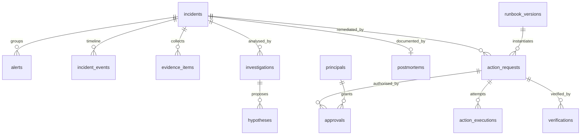

# Sentinel — Data Model (PostgreSQL 18)

All tables use `uuid` PKs (UUIDv7, so they sort by time) and `timestamptz` in UTC. JSONB columns are validated by Pydantic before write. Alembic owns all DDL (`src/sentinel/migrations`).

> **Implemented in migration 0001 (Phase 3):** `incidents`, `alerts`, `incident_events`, `deployments`, `principals`, `jobs`, `audit_events`. Migration 0002 (Phase 4) adds `evidence_collections` and `evidence_items`. The remaining tables arrive with their phases (investigations/hypotheses: 5, runbooks/actions/approvals/executions/verifications: 6, postmortems: 7).
>
> **Deviation from the Phase 1 design:** there is no `services` table. Incidents and deployments carry `service` + `environment` as validated text, and grouping uses `dedupe_key = environment/service`. A table would add a join with no current consumer; it can be introduced when per-service metadata (owners, SLO targets) is needed.

## Tables

| Table | Key columns | Notes |
|---|---|---|
| `alerts` | `id, fingerprint, starts_at, status, alertname, service, severity, summary, labels jsonb, annotations jsonb, generator_url, ends_at, first/last_received_at, receive_count, incident_id fk` | Unique `(fingerprint, starts_at)` gives dedupe; repeated notifications bump `receive_count` |
| `incidents` | `id, number (sequence → INC-0001), service, environment, dedupe_key, title, status, severity, opened_at, acknowledged_at/by, resolved_at, resolution, resolved_verified, closed_at, updated_at, version` | `version` for optimistic locking. Partial unique index on `dedupe_key WHERE status NOT IN ('resolved','closed')`, so there is only one active incident per key. `resolved_verified=false` marks manual resolution |
| `incident_events` | `id, incident_id, at, kind, actor, summary, data jsonb, correlation_id` | Timeline for the UI and postmortem |
| `deployments` | `id, service, environment, version, config_revision, previous_version, previous_config_revision, deployed_at, deployed_by, source, change_ref, recorded_at` | Unique (NULLS NOT DISTINCT) on `(service, version, config_revision, deployed_at)`, so recording is idempotent |
| `evidence_collections` | `id, incident_id, status (complete/partial/failed), window_start, window_end, onset, errors jsonb, started_at, finished_at, trigger` | One per collection run; refreshes add new ones |
| `evidence_items` | `id, collection_id, incident_id, position, ref (unique per collection, e.g. metric.error_ratio), kind (metric/log/change/derived/gap), source, title, summary, query, data jsonb, flags text[]` | **Observations, derived signals and data gaps only, never AI output.** `flags`: `primary`, `no_data`, `redacted`, `truncated`, `possible_prompt_injection`. App role: INSERT/SELECT only (immutable) |
| `investigations` | `id, incident_id, status (pending/running/succeeded/failed), provider, model, prompt_version, input_hash, started_at, finished_at, error, report jsonb, rejected_suggestions jsonb` | Full validated report stored |
| `hypotheses` | `id, investigation_id, rank, statement, confidence numeric(3,2), cited_evidence uuid[], is_primary bool, generated bool default true` | **AI-generated** |
| `runbook_versions` | `id, runbook_id, version, content_sha256, definition jsonb, loaded_at` | Unique `(runbook_id, version)` |
| `action_requests` | `id, incident_id, runbook_version_id, action_type, parameters jsonb, params_sha256, idempotency_key unique, status, source (ai_recommendation/human/policy), requested_by, dry_run bool, created_at, expires_at` | State machine below |
| `approvals` | `id, action_request_id, principal_id, decision (approved/rejected), reason, params_sha256, runbook_sha256, decided_at` | Binds to the exact parameters and runbook content |
| `action_executions` | `id, action_request_id, attempt, started_at, finished_at, outcome, actuator_response jsonb, error` | One row per bounded retry |
| `verifications` | `id, action_request_id, criteria jsonb, samples jsonb, passed bool, started_at, finished_at` | Measured values are stored |
| `postmortems` | `id, incident_id, status (draft/final), markdown, generated_sections jsonb, authored_by, updated_at` | AI-drafted sections are flagged |
| `principals` | `id, name, role, token_sha256, active, created_at` | Bootstrap admin from secret |
| `jobs` | `id, kind, payload jsonb, status, dedupe_key, attempts, max_attempts, run_after, locked_by, locked_at, last_error, created_at, finished_at` | Queue via `SKIP LOCKED`. Partial unique `dedupe_key` while pending/running |
| `audit_events` | `seq bigserial, id, at, actor, action, subject_type, subject_id, correlation_id, data jsonb, prev_hash, hash` | Append-only: a trigger blocks UPDATE/DELETE/TRUNCATE for every role. SHA-256 chain over canonical JSON (UTC timestamps), appends serialised by an advisory lock |

## State machines

**Incident**: `open → acknowledged → investigating → remediating → verifying → resolved → closed`.
Also allowed: `any open state → resolved` (manual resolve requires a reason and is audited); `verifying → remediating` (verification failed); `resolved → open` (re-fire within the reopen window, default 10 min).

**ActionRequest**: `proposed → pending_approval → approved → executing → verifying → succeeded`.
Terminal states: `rejected`, `expired`, `failed`, `verification_failed`, `cancelled`, `superseded`. A policy auto-approve transition `proposed → approved` is recorded as `actor=policy:<rule>`.

## Roles (DB)

- `sentinel_migrator`: owns the schema (DDL), used only by `alembic upgrade`.
- `sentinel_app`: DML on all tables except `audit_events` (INSERT/SELECT only); SELECT on `alembic_version` (readiness). No DDL. Verified by `tests/integration/test_database.py`.
- Both roles are created by `sentinel db init` (the `sentinel-migrate` one-shot service), the only place the superuser password is used.
